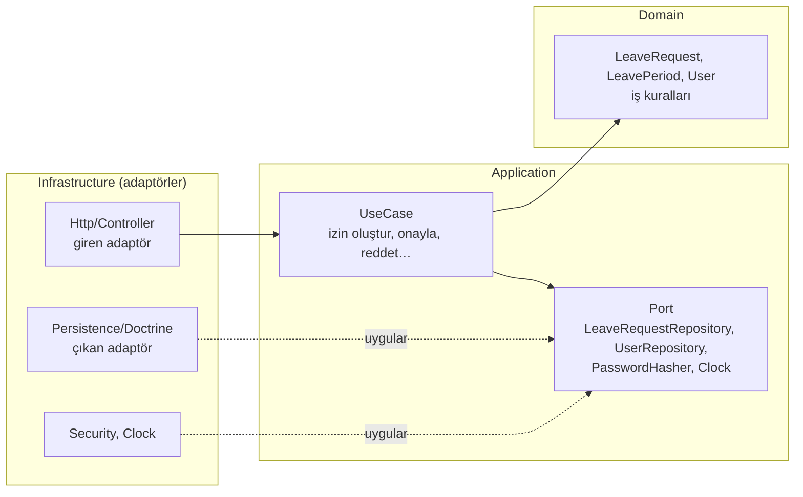

# Rol Bazlı İzin Talep Uygulaması

Şirket içi kullanım için basit bir izin talep sistemi. Çalışan izin talebi oluşturur ve takip eder; yönetici yalnızca kendi ekibinin taleplerini onaylar veya açıklamayla reddeder.

| Katman | Teknoloji | Klasör | Adres |
|---|---|---|---|
| Backend (REST API) | PHP 8.2+, Symfony 7.4, Doctrine ORM, LexikJWT, hexagonal mimari | kök klasör (`src/`, `config/`) | http://127.0.0.1:8000/api |
| Frontend | Nuxt 3, TypeScript, Pinia, Tailwind CSS | `frontend/` | http://localhost:3000 |
| Veritabanı | MariaDB / MySQL | — | `leave_db` |

## Roller ve iş kuralları

- **Çalışan (`ROLE_USER`):** kendi izin talebini oluşturur, listeler, durumunu ve kalan bakiyesini görür.
- **Yönetici (`ROLE_ADMIN`):** kendi ekibinin (departmanının) taleplerini görür, onaylar veya reddeder; ekibine çalışan ekler ve bakiye günceller.

1. Çalışan sadece kendi izinlerini görebilir.
2. Yönetici sadece kendi ekibinin izinlerini onaylayabilir/reddedebilir (kendi talebini de onaylayamaz).
3. Reddedilen izinlerde açıklama zorunludur.
4. Yetkisiz kullanıcılar ilgili uç noktalara ve sayfalara erişemez (API: 401/403, arayüz: yönlendirme).

Ek kurallar: izin bakiyesi iş günü olarak tutulur ve onayda düşer; geçmiş tarihli, bitişi başlangıçtan önce olan, bakiyeyi aşan veya mevcut bir taleple çakışan talepler reddedilir.

## Kurulum

Gereksinimler: PHP 8.2+, Composer, MySQL/MariaDB (ör. XAMPP), Node.js 20+.

### Backend

```bash
composer install

# .env.local oluşturup kendi değerlerinizi yazın
# DATABASE_URL="mysql://root:@127.0.0.1:3306/leave_db?serverVersion=10.11.16-MariaDB&charset=utf8mb4"
# JWT_PASSPHRASE=kendi_parolaniz

php bin/console doctrine:database:create
php bin/console doctrine:schema:update --force
php bin/console doctrine:fixtures:load
php bin/console lexik:jwt:generate-keypair

php -S 127.0.0.1:8000 -t public
```

> Windows'ta `lexik:jwt:generate-keypair` "No such process" hatası verirse:
> `$env:OPENSSL_CONF="C:\xampp\php\extras\ssl\openssl.cnf"` çalıştırıp komutu tekrarlayın.

### Frontend

```bash
cd frontend
npm install        # PowerShell'de: npm.cmd install
npm run dev        # PowerShell'de: npm.cmd run dev
```

## Test kullanıcıları

Tümünün şifresi: `Test1234`

| E-posta | Rol | Ekip | Bakiye |
|---|---|---|---|
| yonetici@test.com | Yönetici | Yazılım | 14 |
| calisan@test.com | Çalışan | Yazılım | 14 |
| calisan2@test.com | Çalışan | Yazılım | 3 |
| ik.yonetici@test.com | Yönetici | İnsan Kaynakları | 14 |
| ik.calisan@test.com | Çalışan | İnsan Kaynakları | 14 |

## API uç noktaları

Giriş dışındaki tüm istekler `Authorization: Bearer <token>` başlığı ister.

| Metot | Adres | Rol | Açıklama |
|---|---|---|---|
| POST | `/api/login_check` | Herkes | `{"email","password"}` → `{"token"}` |
| GET | `/api/me` | Çalışan | Giriş yapan kullanıcı, rol, ekip, bakiye |
| GET | `/api/leaves` | Çalışan | Kendi izin talepleri |
| POST | `/api/leaves` | Çalışan | `{"startDate","endDate","reason"}` (YYYY-MM-DD) |
| GET | `/api/admin/leaves/pending` | Yönetici | Ekibin bekleyen talepleri |
| GET | `/api/admin/leaves?status=` | Yönetici | Ekibin tüm talepleri |
| PATCH | `/api/admin/leaves/{id}/approve` | Yönetici | Onay; bakiyeden düşer |
| PATCH | `/api/admin/leaves/{id}/reject` | Yönetici | `{"reason"}` zorunlu |
| GET | `/api/admin/users` | Yönetici | Ekipteki kullanıcılar |
| POST | `/api/admin/users` | Yönetici | `{"email","password","leaveBalance"}` |
| PATCH | `/api/admin/users/{id}` | Yönetici | `{"leaveBalance"}` |

Hatalar JSON döner: `{"error": "..."}` ve durum kodu (400, 401, 403, 404, 409, 500).

## Mimari: hexagonal (ports & adapters)

Backend, iş kurallarını framework'ten ayıran **hexagonal mimariyle** yazılmıştır. Bağımlılıklar her zaman **dıştan içe** doğrudur:



| Katman | Klasör | Ne içerir | Neye bağımlı olabilir |
|---|---|---|---|
| **Domain** | `src/Domain` | `LeaveRequest` (submit / approve / reject), `LeavePeriod` (iş günü, çakışma), `User`, `Department`, kural hataları | Hiçbir şeye (Symfony ve Doctrine yok) |
| **Application** | `src/Application` | `UseCase/*` (her işlem bir sınıf), `Port/*` (arayüzler) | Domain |
| **Infrastructure** | `src/Infrastructure` | İnce controller'lar, Doctrine repository'leri ve XML eşlemeleri, güvenlik adaptörü, JSON dönüştürücüler, hata → HTTP durum kodu | Application, Domain, framework'ler |

Bir isteğin yolu: `HTTP → Controller → UseCase → Domain kuralları → Port → Doctrine → MariaDB`.

- **Domain Doctrine'i bilmez:** veritabanı eşlemeleri `src/Infrastructure/Persistence/Doctrine/Mapping/*.orm.xml` dosyalarındadır.
- **Kural ihlalleri** domain exception olarak fırlar (`ValidationFailed` → 400, `AccessDenied` → 403, `NotFound` → 404, `Conflict` → 409); `Infrastructure/Http/EventSubscriber/ApiSubscriber` bunları JSON hataya çevirir.
- **Kurallar otomatik kontrol edilir:** [`deptrac.yaml`](deptrac.yaml) katmanlar arası izinli bağımlılıkları tanımlar; yanlış yöne bir bağımlılık eklenirse `vendor/bin/deptrac analyse` ve CI hata verir.

## Proje yapısı

```
src/
  Domain/
    Leave/          LeaveRequest, LeavePeriod, LeaveStatus
    User/           User, Department
    Exception/      ValidationFailed, AccessDenied, NotFound, Conflict
  Application/
    Port/           LeaveRequestRepository, UserRepository, PasswordHasher, Clock
    UseCase/        Leave/ (Submit, Approve, Reject, ListMy, ListTeam), User/ (AddTeamMember, ChangeLeaveBalance, ListTeamMembers)
  Infrastructure/
    Http/           Controller/ (ince API uç noktaları), Presenter/ (JSON), EventSubscriber/ (CORS, hata → JSON)
    Persistence/    Doctrine repository'leri ve XML eşlemeleri
    Security/       SecurityUser, SecurityUserProvider, SymfonyPasswordHasher
    Clock/          SystemClock
  DataFixtures/     Test verisi (domain kurallarından geçerek oluşturulur)
config/packages/security.yaml   JWT girişi ve rol bazlı erişim kuralları
deptrac.yaml                    Mimari kurallar
frontend/
  pages/            login, dashboard, izin oluştur, izinlerim, yönetici onay, kullanıcı yönetimi
  stores/auth.ts    Token ve kullanıcı bilgisi (Pinia)
  composables/      API istek yardımcısı
  middleware/       Sayfa erişim kontrolü
```

## Test

```bash
php bin/phpunit              # 78 test: API + birim
vendor/bin/deptrac analyse   # mimari kurallar
```

| Test grubu | Klasör | Ne doğrular | Gereken |
|---|---|---|---|
| API testleri | `tests/Api` | Tüm uç noktalar: giriş ve yetki, izin kuralları, onay/ret, kullanıcı yönetimi | SQLite (her test sıfırdan kurulur, MariaDB'ye dokunmaz) |
| Domain testleri | `tests/Unit/Domain` | İş günü hesabı, bakiye, çakışma, onay yetkisi | Hiçbir şey |
| Use case testleri | `tests/Unit/Application` | Use case'ler, bellek içi sahte adaptörlerle (`tests/Support`) | Hiçbir şey |

GitHub Actions ([`.github/workflows/ci.yml`](.github/workflows/ci.yml)) her push'ta testleri ve Deptrac'ı çalıştırır.

Manuel test senaryoları (32 senaryo), Postman koleksiyonu ve bulunan hatalar test dokümanında yer alır.
